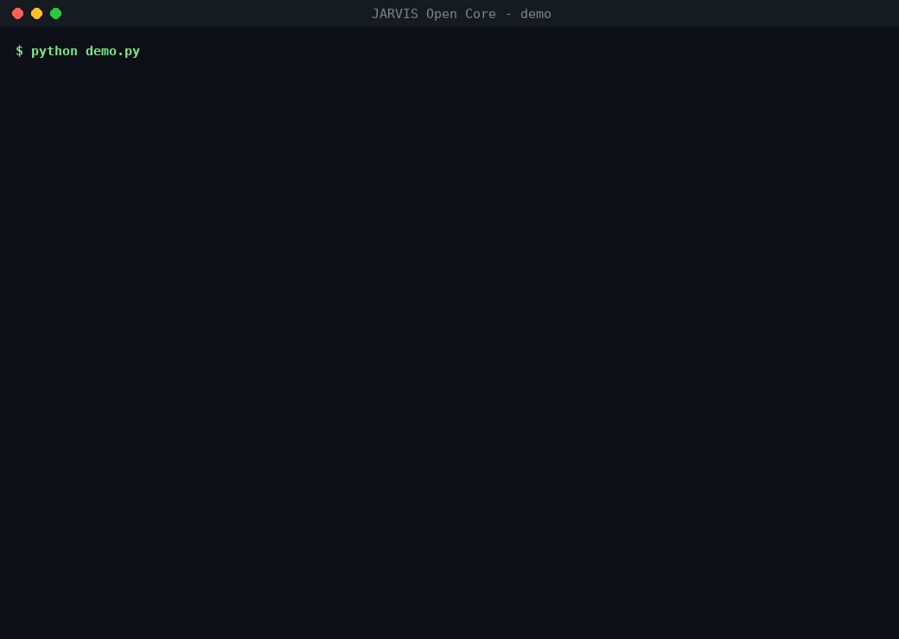

# JARVIS Open Core

[](https://github.com/studiospampinato77-source/JARVIS-Open-Core/actions/workflows/demo.yml)
  

**English** · [Italiano](#italiano)

Guard-rails for small AI agents that do real work for a one-person business: they read public data, grade how much each piece of evidence is worth, and **never act on the outside world without a human "yes"**.



This repository is the open part of JARVIS, an assistant that runs on a single CPU-only server (12 cores, no GPU, local model `qwen3:8b` via Ollama). JARVIS supports an Italian consultant who helps small businesses in financial difficulty. Business data, documents and credentials stay private; the reusable building blocks are published here.

## Try it (one command, no keys, no network)

```bash
git clone https://github.com/studiospampinato77-source/JARVIS-Open-Core.git
cd JARVIS-Open-Core
python demo.py                          # the demo above
python -m unittest discover -s tests    # 23 unit tests (+19 built-in checks)
```

GitHub Actions runs both on every push (Python 3.10 and 3.12): see the badge above.

## What is in it

| Module | What it does |
|---|---|
| `CORE/jarvis_action_gate_v1.py` | **Human-approved outbound actions.** `prepare → approve → execute`. Approval is bound to a SHA-256 of the exact content; changed content, a second send, an opted-out recipient, the daily limit or the STOP file all refuse execution. Payments are disabled by default. Every event goes to a **hash-chained audit log**: editing or deleting a past line is detected. Executors are pluggable; the default writes `.eml` files to a local outbox and never sends. |
| `CORE/jarvis_strategy_layer_v1.py` | Turns an objective into a mission plan (optionally with a local model). `request_action()` blocks email, messages, publishing and payments until a matching approval exists. |
| `ARMS/RESEARCH/jarvis_ingestion_gateway_v5.py` + `GOVERNANCE/ingestion_access_catalog_v5.json` | Single controlled entry for external data: access class (public / login required / licence restricted…), SHA-256, retrieval vs. observation time, freshness, quality. Network **off by default**; login-only or licensed sources are refused. Duplicates and conflicting sources are kept and flagged. |
| `ARMS/RESEARCH/jarvis_evidence_gold_gate_v5.py` | Grades claims RAW → BRONZE → SILVER → GOLD → GOLD_PLUS. Model output is always *inference*, never fact. Copies of one text are not independent sources. Stale data, missing provenance or contrary evidence block GOLD. |
| `ARMS/RESEARCH/jarvis_source_intelligence_v5.py`, `jarvis_experience_loop_v5.py` | Navigation router and learning loop: the agent learns only from GOLD-verified outcomes (an HTTP 200 is a technical success, not a result). |
| `ARMS/SOURCES/jarvis_official_sources_v1.py` | Official text of Italian law articles from Normattiva, also as in force at a past date, cached with the source URL. Public legislation only. |
| `ARMS/WORLD/jarvis_world_core_v4_clienti.py` | Ranks Italian cities with public signals only (OpenStreetMap businesses inside the municipal boundary, crisis news of the last 90 days, population). |
| `BENCH/jarvis_quote_benchmark_v1.py` | **Do open models quote the source or invent it?** Each model answers questions on public law articles and must return verbatim quotes; every quote is checked mechanically against the source. Measures speed too. Works with Ollama or any OpenAI-compatible GPU endpoint. |

Python standard library only. Configuration only through environment variables: `JARVIS_DATA_DIR` (default `./data`), `JARVIS_ROOT`, `JARVIS_CONTACT` (OpenStreetMap User-Agent), `OLLAMA_URL`, `JARVIS_MODEL`.

## First benchmark results (CPU only)

7 questions on public Italian law articles (`BENCH/corpus_it_law.json`: Civil Code, Civil Procedure, Business Crisis Code, from Normattiva), 23 October 2026, 12-core CPU VPS, no GPU, shared with other jobs (raw data in `BENCH/results/`).

| Model | Context | Valid JSON | Quotes found in the right article | Avg s/doc | Output tok/s |
|---|---|---|---|---|---|
| qwen3:8b | short: one article | 100% | **16/16 (100%)** | 39.5 | 8.6 |
| gemma3:4b | short: one article | 100% | **9/9 (100%)** | 20.7 | 12.6 |
| qwen3:8b | long: all 7 articles together | 100% | **18/18 (100%)** | 67.9 | 7.3 |
| gemma3:4b | long: all 7 articles together | 86% | **6/9 (67%)** | 23.2 | 12.6 |

What it shows so far:
- On one short article both models quote correctly. When they must find the right passage among 7 articles, the smaller model drops to 67% of quotes found and one malformed answer, while qwen3:8b stays at 100% but takes about a minute per question on CPU.
- Real case files are much longer than this (hundreds of pages): that is where our private run found 21% of quotes not in the document. Measuring larger open models on long public documents is what needs GPU time.

Re-run it yourself: `python BENCH/jarvis_quote_benchmark_v1.py --mode long --models qwen3:8b gemma3:4b`

## What the private JARVIS does with these blocks (not published)

The modules below run every day on the same CPU server. Their code is private because it holds credentials, customer data or legal files; we describe them so the open blocks can be judged in context.

- **B2B outreach email**: finds professional contacts published on public websites (associations, accountants, local press, podcasts), drafts the message, and sends at most 25 per day through the same approve-then-execute rule, with an opt-out line in every email. First day: 25 sent, 0 errors; 8 wrong contacts caught by automatic checks before sending.
- **Social posts**: a queue of posts approved once by the owner, published twice a day.
- **Digital product delivery**: when an order is paid, it builds a personalised 3D page and emails the link to the buyer, in minutes, with no human step and no duplicates.
- **Legal document check**: for a ~200-page court file, every passage quoted by the local model was checked against the document: of 1,538 quotes, 322 (21%) were not found and were flagged for the lawyer. This is exactly the problem the benchmark measures.
- **Weekly scans** of public funding calls (incentivi.gov.it), EU tenders (TED API) and the Official Gazette, and a weekly WORLD run on 24 cities (~2,900 businesses from OpenStreetMap).

## What we would do with GPU compute

1. Run the quote benchmark on open-weight models larger than `qwen3:8b` (14B–70B class) on a larger set of **public** Italian documents (laws, public court decisions, public company news).
2. Publish the numbers per model: valid answers, **share of quotes really found in the source**, seconds per document, tokens per second, cost per document.
3. Keep the same rule everywhere: the model writes drafts; the gateway, the gold gate, the action gate and a human decide.

## Limits (honestly)

- This is not an autonomous agent and does not try to be one: every external action needs a human.
- PDF, OCR and Office readers, web search adapters and the private business modules are not included; for those formats the gateway returns `READER_NOT_INCLUDED`.
- CPU benchmark numbers come from a shared server and are slow by nature; they are a baseline, not a model ranking.
- WORLD scores are a starting point for research, not a judgement on any city or company.

## License

MIT, see [LICENSE](LICENSE). OpenStreetMap data © OpenStreetMap contributors (ODbL). Law texts from Normattiva (Italian legislation is not protected by copyright, L. 633/1941 art. 5).

---

<a id="italiano"></a>
## Italiano

Paletti di sicurezza per piccoli agenti di IA che fanno lavoro vero per un'attività di una sola persona: leggono dati pubblici, giudicano quanto vale una prova e **non agiscono mai all'esterno senza il "sì" di una persona**.

È la parte aperta di JARVIS, un assistente che gira su un solo server senza GPU (12 core, modello locale `qwen3:8b` con Ollama) e aiuta un consulente italiano che assiste piccole imprese in difficoltà. Dati, documenti e credenziali restano privati; qui ci sono i mattoni riutilizzabili.

### Cosa contiene
- **Action gate**: prepara → approva → esegue. L'approvazione vale solo per quel contenuto preciso; contenuto cambiato, doppio invio, destinatario che ha detto NO, limite giornaliero o file STOP bloccano tutto. Registro a catena di impronte: se qualcuno modifica una riga, si scopre.
- **Ingestion gateway** ed **Evidence Gold Gate**: ogni dato ha fonte, impronta e data; quello che scrive un modello è sempre "inferenza", mai un fatto.
- **Fonti ufficiali**: testo ufficiale degli articoli di legge da Normattiva.
- **WORLD core**: classifica le città italiane con soli dati pubblici.
- **Benchmark delle citazioni**: misura se i modelli aperti citano davvero il testo o inventano.

### Come si prova
```bash
python demo.py
python -m unittest discover -s tests
```
Non servono rete, modello né chiavi.

### Cosa faremmo con la GPU
Confrontare modelli aperti più grandi di `qwen3:8b` su documenti italiani **pubblici**, misurando quante citazioni si trovano davvero nel testo, velocità e costo, e pubblicare qui numeri e script.

### Licenza
MIT. Dati OpenStreetMap © contributori OpenStreetMap (ODbL). Testi di legge da Normattiva.
